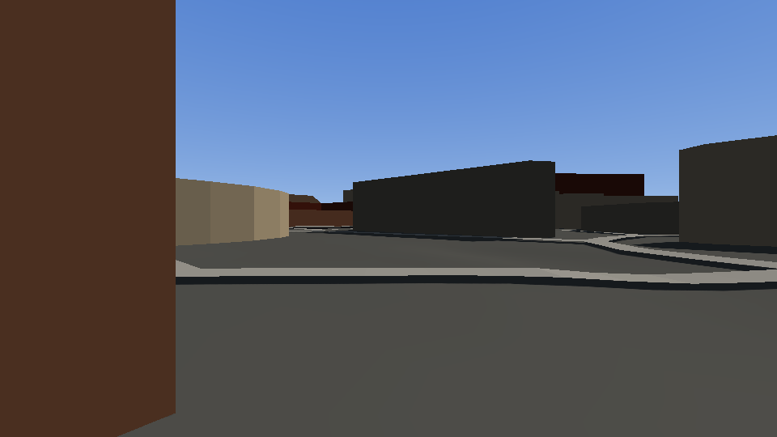

# ponderosa

A walkable 3D map made only from open map and elevation data, rendered with
[Strata](https://github.com/Preponderous-Software/strata). `ponderosa` is the project name.

It covers all of Fort Collins, in 500 m tiles that load and unload as you walk or fly, over a coarse overview of the
whole city. The repository also holds a small sample, 2 km by 2 km of Old Town, which is what the tests build. The
same tile format is meant to carry a county and then the state.




*Rendered headless by the real viewer. Map data © OpenStreetMap contributors (ODbL); elevation courtesy of the USGS.*

## Running it

Needs Python 3.12 via [uv](https://docs.astral.sh/uv/), CMake ≥ 3.24, a C++17 compiler and OpenGL 4.5.

The Old Town sample builds offline from what is committed:

```sh
uv run ponderosa verify     # the raw data matches data/raw/SOURCES.json
uv run ponderosa build      # -> build/tiles/
cmake -S . -B build/app && cmake --build build/app -j4
./build/app/ponderosa
```

To refresh the sample, `uv run ponderosa fetch` downloads it into `build/fetched`, which is never committed, because a
full OpenStreetMap download carries contributor names and business contact details. `uv run ponderosa sanitize` then
reduces it to the geometry and the few tags the build reads.

The whole city's raw data is too large to commit, so `city/SOURCES.json` pins its URLs and checksums instead:

```sh
uv run --extra city ponderosa fetch --area city.json    # -> build/fort-collins-raw/, about 870 MB
uv run --extra city ponderosa verify --area city.json
uv run --extra city ponderosa build --area city.json    # -> build/fort-collins/; --resume keeps finished tiles
./build/app/ponderosa --tiles build/fort-collins
```

`city.json` names an OSM boundary relation, and the tiles are the ones within its margin, so the grid is not a
rectangle. Only the tags the build reads are taken from the regional extract, so names and addresses do not reach a
tile.

WASD walks and Shift runs. The mouse or arrow keys look. **F** switches to flying: WASD follows your view at 20 m/s
(Shift four times that), E or Space climbs, Q or Ctrl descends, and F again lands you on the ground, outside any building.
Flying stops at the edge of the overview, up to 400 m above the ground, and you can only land where there are tiles. The mouse wheel or Page Up and Page Down change your speed, from 5 to 800 m/s in the air. `-` and `=` shorten or lengthen the view, 200 to 1,500 m of detailed tiles (the default is 700 m). H shows or hides this list on screen. A panel in the corner shows your mode, speed, height and view, and Tab hides it. `,` `.` change mouse sensitivity, and 9 and 0 change the field of view. Speed, view, sensitivity, field of view and the panel are remembered between runs, in `ponderosa/settings.txt` under your user configuration folder; delete it to go back to the defaults. R takes you back to where you started. `[` `]` change the time of day and P saves a screenshot. Esc
frees the mouse, a click takes it back, and Esc again quits.

Headless:

```sh
LIBGL_ALWAYS_SOFTWARE=1 GALLIUM_DRIVER=llvmpipe ./build/app/ponderosa --headless --yaw 90 --walk-ahead 30 --screenshot out.png
./build/app/ponderosa --headless --radius 300 --pass-east -900 --bench 20
```

`--pass-east` and `--pass-north` move straight through everything and fail if no tile unloaded.

## How the tiles work

- **The grid is global.** A tile is a 500 m square of UTM zone 13N, named by `floor(east / 500)` and
  `floor(north / 500)`. Its name never depends on which area was built, so areas can grow without renaming.
- **Tiles are self-contained.** Positions are relative to the tile's north-west corner, and the viewer adds the offset
  on load. Precision stays the same wherever the tile is, which is what a state-sized map needs from 32-bit floats.
- **No seams.** Neighbours share their edge samples, and each height grid has one extra row all round so normals match
  across the edge. A feature belongs to the tile holding its centre, and may overhang into the next tile.
- **Streaming is a pure function.** `app/streaming.h` takes the position and what is loaded, and returns what to load
  and unload. A tile loads within the load radius, stays until 200 m beyond it, and the budget keeps Strata under its
  limit of 256 meshes at four meshes a tile.
- **Terrain is a static mesh per tile**, not `strata_set_terrain`, because Strata holds one terrain tile at a time.
- **The overview is that one terrain tile.** It covers the whole area at about 20 m, with colours tinted by how much
  of each sample is roof or road. Every sample sits a metre below the lowest detailed ground in reach, so the loaded
  tiles always cover it, and the camera's near plane lifts with height to keep the two apart at a distance.

The layout is documented at the top of `ponderosa/tiles.py`. `manifest.txt` lists every tile with its size and hash.

## Measurements

From this 4 km² build, on 2026-11-03. The area is a dense city centre, so these are the high end for a city.

| | |
|---|---|
| Disk | 33.0 MB, or 8.25 MB per km² (about 2.8 MB per km² gzipped) |
| Contents | 3,838 buildings, 942 trees, 2 m terrain |
| Load time per tile | 0.4 ms read, 7 to 8 ms mesh upload, 12 ms at worst, on the main thread with llvmpipe |
| Held at once | 11 tiles and 44 of 256 meshes at the default 700 m radius |
| Frame time | 130 to 280 ms on llvmpipe (software), which says nothing about a real GPU |

## Limits of this spike

- Everything loads on the main thread, one tile a frame.
- There is no level of detail, so a distant tile costs what a near one does.
- Colorado spans UTM zones 12 and 13. One zone stretched across the state will need checking before the state stage.
- Only four-cornered footprints get a gabled roof. Multipolygon holes in buildings are ignored.
- Water is only a colour, and you can walk on it.
- Eye height follows bare-earth elevation, and bridges are not modelled.
